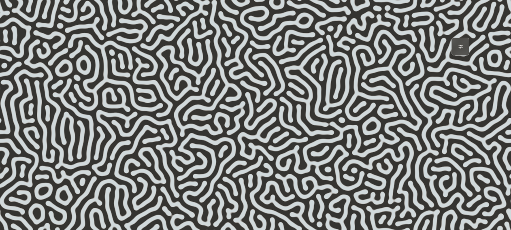

# Кораллы — живые обои для Windows

Живой узор реакции-диффузии (Gray–Scott) на весь рабочий стол: кораллы растут сами,
акулы проедают в них коридоры, курсор подливает реагент. Работает как HTML-обои
в [Lively Wallpaper](https://www.rocksdanister.com/lively/).



## Установить в одну команду

Windows 10 1903+ / Windows 11. Открой **PowerShell** (Win + X → «Терминал» / «PowerShell»)
и вставь одну строку:

```powershell
irm https://raw.githubusercontent.com/Appappars/corals-live-wallpaper/main/install.ps1 | iex
```

Скрипт сам:
1. поставит **Lively Wallpaper** через winget, если его ещё нет (может спросить UAC);
2. скачает обои и положит их в библиотеку Lively;
3. запустит Lively и применит обои на все экраны.

Больше ничего нажимать не нужно. Если Lively уже стоит — установка займёт пару секунд.

> Не любишь консоль? Скачай [`install-corals.cmd`](install-corals.cmd) и запусти двойным
> кликом — он делает то же самое.

## Установить вручную

1. Поставь [Lively Wallpaper](https://www.rocksdanister.com/lively/) (бесплатно, open source).
2. Скачай [`corals.zip`](https://github.com/Appappars/corals-live-wallpaper/releases/latest/download/corals.zip).
3. Перетащи zip прямо в окно Lively — он импортируется в библиотеку.
4. Нажми на плитку **Corals - live wallpaper** — обои применятся.

Альтернатива без zip: скопируй папку [`wallpaper/`](wallpaper) в
`%LOCALAPPDATA%\Lively Wallpaper\Library\wallpapers\corals` и перезапусти Lively.

## Управление

| Что | Как |
| --- | --- |
| Панель настроек | значок ползунков в правом верхнем углу, закрыть — `Esc` |
| Подлить реагент | тянуть курсором по рабочему столу |
| Вспышка роста | клик |
| Сменить рецепт (коралл / черви / деление / волны) | колесо мыши |
| Пересеять узор | `R` |

В панели: скорость реакции, корм, яд, количество акул, детализация (50–200 %), день/ночь,
авторассев. Настройки запоминаются в localStorage Lively.

## Требования

- Windows 10 1903+ или Windows 11
- Lively Wallpaper 2.x
- WebGL2 (есть во всех современных драйверах; без него включается медленный CPU-режим)
- ~1 % ядра на экран; Lively ставит обои на паузу в полноэкранных играх

## Как это сделано

- Симуляция Gray–Scott на WebGL2: ping-pong RGBA16F, разрешение поля зависит от ползунка
  «Детализация».
- Акулы — 3D-модель, встроенная в HTML (base64), рисуется поверх поля и выедает коридоры.
- Всё в одном файле `wallpaper/corals.html` (~2,8 МБ), без внешних запросов и CDN.

## Лицензии

- Код обоев: MIT — делай что хочешь, ссылка приятна.
- 3D-модель акулы: [Quaternius](https://quaternius.com/) (CC0).
- Скат Steren Giannini (CC-BY, poly.pizza) остался в файле как резервная модель —
  атрибуция сохранена в панели настроек.

---

### English

Corals is an animated HTML wallpaper for [Lively Wallpaper](https://www.rocksdanister.com/lively/):
Gray–Scott reaction-diffusion corals that grow on their own, with sharks carving corridors
through them. One-line install:

```powershell
irm https://raw.githubusercontent.com/Appappars/corals-live-wallpaper/main/install.ps1 | iex
```

Manual: download [`corals.zip`](https://github.com/Appappars/corals-live-wallpaper/releases/latest/download/corals.zip),
drag it into Lively, click the "Corals - live wallpaper" tile. MIT licensed, shark model CC0.